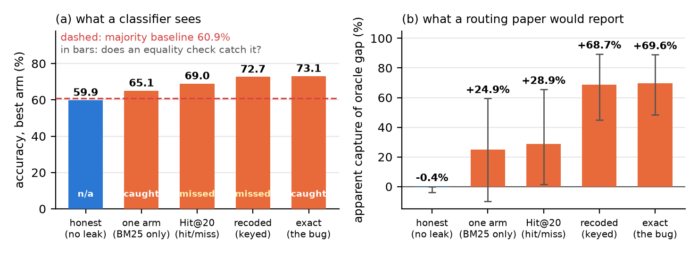

# Metric-as-Feature Leakage in Retriever Routing

[](https://github.com/Soumya080/metric-feature-leakage/actions/workflows/tests.yml)

Code, data and the `leakcheck` audit tool for

> **Metric-as-Feature Leakage: A Feature-Side Failure Mode in Retriever Routing**
> Soumy Sawant, Chirag Joshi (Manipal University Jaipur)
> NewInML Workshop at NeurIPS 2026, Paris



## Summary

A learned router that picks BM25, Dense or Hybrid retrieval per query appeared to beat every
fixed retriever. Four of its 61 features had been computed from the evaluation metric
(MRR@20), which equals the reward for two of the three arms. We use this bug as a controlled
case of target leakage: with the reward table fixed and only the leaked features varied,
accuracy at predicting the best retriever rises from 59.9% (label-free; majority 60.9%) to
73.1%, and noised versions of the leak that match no reward value keep much of the gain, so
an equality check does not catch them. Without the leak, no method we tested beats committing
to one retriever on these arms.

## Installation

```bash
git clone https://github.com/Soumya080/metric-feature-leakage
cd metric-feature-leakage
pip install -r requirements.txt     # full pipeline
pip install -e ".[test]"            # leakcheck + tests only (numpy, scikit-learn, pytest)
```

Python 3.10+. No GPU is needed for anything below.

## Quick start

```bash
python examples/leak_demo.py                  # the leakage mechanism on synthetic data (~3 min)
python -m pytest leakcheck/tests tests -q     # detector and leak-guard tests
```

Audit your own router. `X` is the `(n, d)` feature matrix, `R` the `(n, k)` per-arm reward
table:

```python
import leakcheck
report = leakcheck.audit(X, R)        # exact-agreement verdicts + rank-based suspicions
print(report)
report_v2 = leakcheck.audit_v2(X, R)  # adds the held-out decodability test
```

See [`leakcheck/README.md`](leakcheck/README.md) for what a clean report does and does not
mean, and [`leakcheck/CALIBRATION.md`](leakcheck/CALIBRATION.md) for how the thresholds were
set.

## Reproducing the paper

All intermediate artifacts (per-query retrieval results and the router's feature and reward
tables) are included, so every number in the paper can be regenerated on a CPU without
re-running retrieval. [`REPRODUCE.md`](REPRODUCE.md) maps each claim, table and figure to the
command and results file behind it. The main entry points:

| Paper element | Script | Output |
|---|---|---|
| Figure 1, leak ladder | `experiments/analyses/plot_leak_ladder.py` | `results/figures/fig12_leak_ladder.pdf` |
| Leak gradient | `experiments/router_experiments/leak_gradient.py` | `results/leak_gradient.json` |
| Routing without the leak (RQ2) | `experiments/router_experiments/canonical_evaluation.py` | `results/canonical_results.json` |
| Permutation control | `experiments/router_experiments/permutation_control.py` | `results/perm_B1000/` |
| Detection power, detector benchmark | `experiments/analyses/detection_power.py`, `detector_benchmark.py` | `results/analyses/` |
| Leak at corpus scale | `experiments/corpus_v3/06_leak_vs_scale.py` | `experiments/corpus_v3/results/leak_vs_scale.json` |
| QueryRoute audit | `experiments/analyses/queryroute_audit.py` | `results/analyses/queryroute_audit/` |

To rebuild everything from raw data (downloads the QA datasets and a Wikipedia passage pool):

```bash
python experiments/baseline_v2/01_prepare_data.py            # questions + 500-passage candidate sets
python experiments/baseline_v2/02_run_baselines.py --dataset all
python -m src.router.prepare_env_data                         # features + per-arm rewards
python experiments/router_experiments/run_full_pipeline.py    # resumable; skips finished stages
```

## Data

`src/router/{nq,triviaqa,hotpotqa}_env_data*.json` hold, per query, the 61 router features and
the reward of each arm. The suffix selects the feature set; the reward table is identical
across all of them.

| Suffix | Features 22–25 | Rung in Figure 1 |
|---|---|---|
| (none) | label-free retrieval-score statistics | honest |
| `_leak1` | BM25's MRR@20; Dense honest | one arm |
| `_leakhit` | Hit@20 of BM25 and Dense | Hit@20 |
| `_leaknoisy` | MRR@20 with a deterministic value-keyed offset | recoded |
| `_leaky` | MRR@20 of BM25 and Dense (the original bug) | exact |
| `_xscore` | honest, plus 6 cross-retriever score features (67 total) | control |
| `_all` | honest, including queries with constructed gold passages | robustness |

`*_layout.json` records the column ranges of each feature group. Per-query retrieval results are
in `experiments/baseline_v2/results/`.

## Repository layout

```text
leakcheck/              standalone, numpy-only leakage audit
src/
  retrieval/            BM25, dense (FAISS) and hybrid (RRF) retrievers
  router/               feature extraction, routing environment, policies and trainers
  evaluation/           retrieval metrics
experiments/
  baseline_v2/          data preparation and per-query retrieval on 500-passage candidate sets
  corpus_v3/            shared-index rebuild at 20K-100K passages
  router_experiments/   routing baselines, leak gradient, permutation and control analyses
  analyses/             noise sweeps, detection power, detector benchmark, external audit
results/                every artifact the paper's numbers are read from
paper/                  LaTeX source and figures
examples/               leak_demo.py
tests/                  leak-guard and data tests
```

## Limitations

Experiments use per-query 500-passage candidate sets (1 gold passage + 499 distractors, about half mined by query-term overlap); the scale
study uses a shared index of up to 100K passages. The reward is the reciprocal rank of the
first answer-bearing passage, a proxy for answer quality. Further caveats, and defects found
in our own artifacts, are listed in [`results/KNOWN_ISSUES.md`](results/KNOWN_ISSUES.md).
Dataset licences are in [`DATA_LICENSES.md`](DATA_LICENSES.md).

## Citation

```bibtex
@inproceedings{sawant2026metricleakage,
  title     = {Metric-as-Feature Leakage: A Feature-Side Failure Mode in Retriever Routing},
  author    = {Sawant, Soumy and Joshi, Chirag},
  booktitle = {NewInML Workshop at the 40th Conference on Neural Information Processing Systems (NeurIPS 2026)},
  year      = {2026}
}
```

## License

MIT. See [`LICENSE`](LICENSE).
